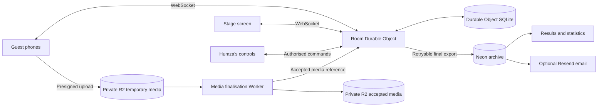

# 26.humza.website - birthday party game plan

[Home](README.md) · [Documentation](docs/README.md) · [Event runbook](docs/event-runbook.md)

Updated: 22 September 2026  
Event: Humza's 26th birthday, 21 November 2026  
Presenter: Baseer  
Screen operator and administrator: Humza  
Status: Consolidated working plan. Agreed product decisions are distinguished from recommended implementation defaults and remaining content choices.

<details>
<summary>On this page</summary>

- [1. Purpose and agreed direction](#1-purpose-and-agreed-direction)
- [2. Surfaces and architecture](#2-surfaces-and-architecture)
- [3. Guest identity and session recovery](#3-guest-identity-and-session-recovery)
- [4. Durable state and memory](#4-durable-state-and-memory)
- [5. Protocol and round state machine](#5-protocol-and-round-state-machine)
- [6. One durable scheduler per room](#6-one-durable-scheduler-per-room)
- [7. Round types and content](#7-round-types-and-content)
- [8. Scoring](#8-scoring)
- [9. Lobby, names and attribution](#9-lobby-names-and-attribution)
- [10. Troll system](#10-troll-system)
- [11. R2 photo and voice pipeline](#11-r2-photo-and-voice-pipeline)
- [12. Browser/device information and end-game statistics](#12-browserdevice-information-and-end-game-statistics)
- [13. Results, archive and email](#13-results-archive-and-email)
- [14. Host controls and security](#14-host-controls-and-security)
- [15. Build sequence](#15-build-sequence)
- [16. Acceptance tests and rehearsal](#16-acceptance-tests-and-rehearsal)
- [17. Remaining content and presentation choices](#17-remaining-content-and-presentation-choices)

</details>

## 1. Purpose and agreed direction

A one-night, in-person multiplayer quiz for 50-plus guests. Questions, reveals, photos, audio and scores appear on a projector; guests answer and vote on their phones.

Keep the experience playful and straightforward. Build the storage, recovery and security to a production standard even though the event happens once.

### Agreed decisions

- Questions generally allow 15-45 seconds for answering. Voting and reveal durations can be configured separately where needed.
- Baseer presents while Humza operates the big screen and live controls.
- Every guest plays individually and gets their own vote. No pods or voting groups.
- Humza supplies the questions. No question CMS or editor; question definitions are versioned TypeScript bundled with the application.
- No guest accounts, signup or passwords. Administrator sign-in is an allow-list on `ADMIN_EMAIL` (Humza and Aden).
- Browser only, with no mobile app or public matchmaking.
- Open on something funny and self-explanatory, preferably multiple choice. No separate warm-up act.
- Trolls unlock from round two. Effects are brief unless deliberately designed as recurring jokes.
- Keep the name-cloud voting, public attribution and playful troll ideas from the original draft.
- Scoring is configured per round. There is no mandatory participation floor, universal 0-1000 scale or automatic 1x/2x/3x progression.
- Browser/device information and gameplay data support entertaining end-of-game statistics and comparisons.
- Rehearsal is already planned.
- Preserve the same room and game when recovering from a failure. A spare room is for testing or a deliberate restart.

### Scope boundaries

No general-purpose admin platform, guest onboarding product, settings dashboard or marketing analytics suite. Event statistics are part of this game and its results.

This document describes Humza's separate birthday project. It does not authorise adding guest media, device tracking or new identity systems to the LifeSmart pupil platform.

## 2. Surfaces and architecture

| Surface | Route | Purpose |
| --- | --- | --- |
| Guest controller | `/` | Join, answer, vote, use trolls, upload media and see submission status |
| Stage | `/host` | Project questions, reveals, scores, names, media and troll announcements |
| Admin | `/admin` | Create rooms, operate the game, recover players and apply overrides |
| Results | `/r/:gameId` | Final standings, highlights, gallery and aggregate statistics |

Recommended application stack: React, TypeScript and Vite for the interfaces; Hono on a Cloudflare Worker for HTTP routes; one SQLite-backed Durable Object per room; R2 for media; Neon for the final archive; Better Auth for admin login; Resend for optional post-game email.

One Worker can serve the application assets and API. Bindings are passed through request context; do not construct runtime services from module-level environment reads.



Guest game actions never await Neon, email or image processing. Those dependencies cannot hold up accepting an answer or casting a vote.

Room codes use an unambiguous alphabet, excluding characters such as O/0 and I/1. Resolve a code to a room ID server-side. Check for collisions when creating a room, and keep each game ID unique even if a code is eventually reused.

## 3. Guest identity and session recovery

### Identity is explicit, not inferred from the device

At join, create a random `playerId` and an unguessable recovery credential. Store a verifier for the credential server-side and deliver the credential in a Secure, HttpOnly, same-origin cookie with a suitable SameSite policy.

The player ID identifies participation in this game. The nickname is editable display text. Renaming or swapping displayed names never changes score ownership or identity.

Authenticate WebSocket connections using the session credential, validate the request origin, and attach the authorised player and room identity to the connection. Authorise every subsequent action against that identity. Never trust a payload's claimed player ID.

The session survives refreshes and changes between Wi-Fi and mobile data. Losing the cookie or moving to another browser requires an explicit recovery flow: Humza can issue a short-lived transfer code that attaches the new browser to the existing player and revokes the old credential.

Recommended duplicate-tab behaviour: the newest controller connection becomes authoritative for that player; older tabs show that the game is active elsewhere. Opening extra tabs never creates extra votes or troll tokens.

### Browser context is separate

Create a `deviceContextId` for the browser session's reported device information. Associate it with the authenticated player. Answers can reference the context used when submitted, so changing phones does not rewrite the historical device statistics.

Do not use IP addresses or a device fingerprint to merge players. Shared venue Wi-Fi can put many guests behind one public IP, and IPs can change. Browser data is useful context, not proof of identity. [IP address sharing reference](https://www.rfc-editor.org/info/rfc6269/)

The site can read its own session and permitted browser APIs. It cannot read other websites' cookies, login sessions, browsing history, private app data or WhatsApp activity.

## 4. Durable state and memory

### Chosen approach

SQLite attached to the room Durable Object is the authoritative live database. Memory is a disposable cache. Persist accepted actions before acknowledging success; do not rely on end-of-round snapshots for recovery.

Cloudflare recommends SQLite-backed Durable Objects, and in-memory state is discarded on hibernation or eviction. [SQLite storage](https://developers.cloudflare.com/durable-objects/api/sqlite-storage-api/) and [lifecycle](https://developers.cloudflare.com/durable-objects/concepts/durable-object-lifecycle/).

| Storage | Contents |
| --- | --- |
| DO SQLite | Room configuration, pinned question version, players, credential verifiers, round state, deadlines, accepted answers/votes, score ledger, tokens, effects, scheduled jobs, media records, device contexts, bounded stats summaries and export status |
| DO memory | Rebuildable caches, temporary typing previews, connection health and current broadcast buffers |
| WebSocket attachments | Small authenticated connection metadata that survives hibernation |
| R2 | Temporary uploads and accepted media under separate keys |
| Neon | Final archived game, results, media references, stats and optional email requests |
| Browser | UI state, pending request IDs and unsubmitted drafts; server data is replaced from a snapshot on reconnect |

### Accepting an action

1. Authenticate the connection and validate the command schema.
2. Check eligibility, current phase/version, deadline and duplicate request ID.
3. Atomically write the accepted action and its consequences, including score/token changes where relevant.
4. Record the new room state version and the result associated with the request ID.
5. Confirm success and publish the appropriate updates.

Related mutations form one transaction. External network calls do not run inside that transaction. If the same request is retried, return its recorded outcome without applying it again. A reused request ID with a different payload is rejected.

Maintain a compact history of accepted actions and score adjustments in SQLite, rather than retaining all answers in a growing JavaScript array. Bound payloads, drafts, queues, telemetry samples and in-memory collections.

### Recovery

- Rebuild room state from SQLite on activation.
- Restore authenticated metadata for surviving sockets through WebSocket attachments. [WebSocket guidance](https://developers.cloudflare.com/durable-objects/best-practices/websockets/)
- Send a role-appropriate snapshot on reconnect or resynchronisation. Guest snapshots never expose other players' unrevealed answers, admin credentials or answer keys.
- Use state versions and a per-connection delivery sequence to detect missed updates. A global room revision need not be contiguous for a guest who receives only a subset of events.
- Reconcile pending scheduled jobs with the currently armed alarm.
- Pin the question-set and scoring version when the room is created. Keep the pinned content available for that game's lifetime.
- Do not perform incompatible deployments during the event.

## 5. Protocol and round state machine

Clients send intent; the server validates and publishes the outcome. There is no client command that sets a score.

Typical guest intents: join/resume, submit answer, cast vote, use troll, typing preview, request upload, finalise upload, report device context, request snapshot and heartbeat.

Typical server outcomes: snapshot, command acknowledgement/rejection, phase change, submission count, reveal, score change, effect applied/expired, player presence and media accepted.

Host commands use an authorised role: advance, pause/resume, skip, re-reveal, hide media, rename/kick/recover player, adjust score and finish game.

Each mutating command includes a protocol version, request ID and relevant round/phase identifier. Set explicit message-size limits and rate limits. Allow snapshot/media/vote-list sizes to scale with a bounded room capacity; avoid sending accumulated game history with each update.

```text
LOBBY -> INTRO -> PROMPT -> COLLECT -> [VOTE] -> REVEAL -> SCORES
                                  next round <- SCORES
                                  final round -> FINAL -> PODIUM
```

Pause is an overlay on the current phase, with remaining time preserved. A round definition chooses its required phases rather than assuming every round needs voting.

Server timestamps govern deadlines. Clients estimate their offset and animate countdowns locally. Reject late submissions using the stored deadline even if an alarm has not yet executed. The default is one accepted answer/vote per eligible player per phase; any editable-answer round must declare its replacement rule explicitly.

## 6. One durable scheduler per room

Cloudflare provides one alarm per Durable Object, and alarm handlers may execute more than once. Use a persistent schedule rather than independent calls to set the alarm from different features. [Alarm reference](https://developers.cloudflare.com/durable-objects/api/alarms/)

### Schedule records

Each job stores a unique ID, purpose, due time, owning round/phase version, payload reference, status and retry information. Jobs include phase deadlines, effect expiry, deferred stage cues and post-game export retries.

Only the scheduler may arm the room alarm. It points to the earliest outstanding due time. Persist schedule changes and arm the alarm consistently; recovery reconciles them. Include this consistency in crash tests, rather than relying on a future guest message to repair a missing alarm.

### Execution rules

1. Load due jobs in stable order.
2. Ignore cancelled jobs and jobs belonging to an obsolete phase version.
3. Commit each local state change and job completion atomically.
4. Schedule the next pending deadline before leaving the handler.

Duplicate execution cannot award a score, spend a token or advance a round twice. Durable export jobs retry with backoff and a visible failure state. External writes use stable idempotency keys or unique database keys.

### Time semantics

- Pause freezes gameplay deadlines and effect durations. Background upload cleanup or export retries can continue.
- Resume calculates new deadlines from saved remaining durations.
- Skip/advance invalidates old phase jobs and tears down temporary round resources.
- Brief visual effects animate locally using their server expiry time. Enforce expiry server-side when processing relevant actions as well.
- A late alarm closes an expired phase once. The next timed phase receives its full duration from the actual transition time; do not catch up by skipping several questions.
- An explicitly paused game never auto-advances.
- If the host is disconnected at a deadline, close collection but hold the reveal/start of the next question until the host reconnects. This is the recommended recovery default.
- Cosmetic typing previews, animation frames and heartbeat measurements do not each create durable jobs.

## 7. Round types and content

Build the common round contract alongside the first multiple-choice round. Share validated configuration and submission schemas; keep scoring and answer keys in server-only modules. Do not import server answer data into a client bundle through a shared barrel.

Each round type supplies configuration validation, submission validation, supported phases, server scoring and separate phone/stage renderers. The server coordinator must support type-specific voting, matching and reveal preparation; these are not all reducible to a single scoring function.

| Type | Interaction and notes |
| --- | --- |
| Multiple choice | Tap an option. Optional speed bonus configured per question. First type to build. |
| Slider | Submit an estimate. Distance-based scoring if desired. Second type to build. |
| Answer and vote | Submit text, then each eligible guest votes on the room-wide candidate set. |
| Guess the guest | Pick a player from a searchable list or a question-specific shortlist. |
| Rank/tierlist | Tap an item, then tap its tier or position. No required drag-and-drop. |
| 1v1 | Simultaneous pairings with an explicit rule for odd numbers, absence and ties. One spectated finale can use a room vote. |
| Photo/voice activity | Explicit media capture/upload with a usable fallback if permissions or format support fail. |

No voting groups. Every eligible player has an individual ballot counted in the same round-wide tally. Candidate selection, votes allowed, self-voting and tie handling are explicit question settings.

Recommended voting UI: compact cards, stable option IDs, a clearly selected choice and a submission acknowledgement. Guess-the-guest lists support search. For text answers, randomise the initial ordering per guest and keep that order stable throughout the phase.

The remaining content choice is whether a given answer-and-vote round includes all submissions or a host-curated shortlist. A shortlist, if used, is still voted on by the whole room. Do not silently reintroduce pods or assume 50 answers can all be read in 15 seconds.

## 8. Scoring

Scoring belongs to each question. The original draft's universal participation floor, mandatory normalisation and automatic weighting are removed.

Supported policies can include fixed points, correctness plus speed, distance bands, vote counts, majority matches, ranking agreement, duel outcomes and deliberately funny score modifiers.

Each scoring round declares maximum/minimum awards, eligibility, tie rules, treatment of missing submissions and any applicable troll interactions. Non-scoring questions are allowed.

Score-changing trolls apply only to rounds that explicitly enable them. Define a stable modifier order so stealing, redirecting and doubling cannot depend on incidental code order. Host adjustments are recorded with a reason and remain distinguishable from earned points.

Disconnected players retain points and accepted submissions. A missing answer follows that round's rule; the game does not wait indefinitely for a disconnected player.

Recommended initial defaults: no self-voting, shared points for tied winners, no speed bonus while a submission-disrupting troll is active, and one clear end-game tie-break question available. These are defaults for Humza to tune, not universal product requirements.

## 9. Lobby, names and attribution

The joining screen is a live name cloud. Keep the QR code and short URL visible throughout the lobby. Guests see their names appear and can like/dislike other names; the cloud scales and recolours accordingly.

Keep the most-liked and most-disliked nickname reveal as an opening beat. Make it non-scoring by default. A configurable cap of around ten name reactions per player preserves the original proposal without requiring everyone to rate every name.

Provide nickname collision handling, maximum lengths, safe text rendering, a clear joined state, connection status and late joining. Late joiners start at zero unless the host makes an explicit adjustment.

Attribution is configured per question:

| Mode | Stage behaviour |
| --- | --- |
| `never` | Do not attach player names to the public answer reveal |
| `after` | Attach names at reveal; default |
| `live` | Show a count and a rolling sample of names while answers arrive |

Public anonymity and server-side attribution are different: the server still associates submissions with a player to score the game. Never describe a question as anonymous to the host if the host can inspect the association.

Effects that expose names or live drafts must be compatible with the round's declared attribution mode. A public name swap is presentation only. A hide control clears sensitive stage content promptly.

## 10. Troll system

One token per guest for the night, available from round two. Effects should be brief, obvious and funny. They add friction or theatre without permanently preventing participation.

The server validates balance, target, phase and effect compatibility. Spending the token and accepting the effect are one durable operation. A retry cannot spend a second token.

Keep one transient effect slot per target and one persistent slot where needed. Proposed defaults: queue briefly if a slot is occupied, expire queued effects when their valid phase ends, and refund an effect that never starts. Stage announcements use a short serial queue so audio and captions do not collide. These are implementation controls, not a requirement for elaborate game balancing.

### Candidate catalogue retained from the original draft

| Group | Ideas |
| --- | --- |
| Screen invasion | A face asset, audio sting and duration; variants are content swaps. Keep a non-political fallback asset. |
| Fake system chrome | Incoming call from Mum; screen-recording banner; 1% battery; update prompt; recurring AirDrop; overheating warning; cracked screen; fake answer viewers; endless Humza typing indicator. |
| Input sabotage | Inverted/drifting slider; dodging submit button; reshuffling options; reverse typing; comic autocorrect; short character limit; Comic Sans/mirrored/upside-down text; temporary translated options; supported-device haptics. |
| Stage theatre | Live typing broadcast; three-second voice clip played later; captioned photo; mock sponsored break; recurring theme song; replay of a bad answer; TTS reading; fake departure announcement; progressively zoomed photo. |
| Identity/display | Temporary nickname; nickname swap; Guest 14; fake last-place display; hidden personal score. |
| Round-specific scoring/social | Misattributed answer; public vote; share a selected player's round score; steal points; redirect points; double-or-nothing. |

Original priority candidates remain: live typing, short voice clips and recurring theme songs, plus reusable screen invasion and a few simple fake-chrome effects. Final selection is a content/build decision; the catalogue is not a promise to ship every effect.

### Implementation details

- Effects are declarative records with an ID, type, target, start/expiry and optional round scope.
- No effect takes ownership of the room state machine.
- Input sabotage has an escape hatch or short automatic timeout. Stable answer IDs survive visual reshuffles.
- Live typing is capped to one stage broadcast at a time; coalesce updates, for example to five per second, rather than broadcasting every keystroke.
- Do not persist every deleted draft for statistics. Persist the final submitted answer and the fact that a typing effect occurred.
- Persistent theme-song stings play through the shared stage audio queue; an expired or skipped cue does not replay after reconnect.
- Provide a stage audio-unlock interaction, master mute and per-cue stop. Phone audio/haptics are best-effort enhancements.
- Media capture requires the browser's permission flow and an explicit guest action; failure never prevents answering other rounds.

## 11. R2 photo and voice pipeline

### Direct upload with controlled finalisation

Use private R2 storage with separate temporary and accepted object keys. Presigned upload URLs remain reusable until expiry, so enforce single acceptance in the application rather than claiming that a signed URL is inherently single-use. [Presigned URL reference](https://developers.cloudflare.com/r2/api/s3/presigned-urls/)

1. A guest requests an upload slot for the current room/round. The room records an upload ID and ownership before issuing a short-lived URL for a server-generated temporary key.
2. The phone resizes a photo to approximately 1280px on its longest edge and encodes JPEG around quality 0.8. Aim for roughly 200KB, but treat that as a target, not a guarantee. Proposed maximum accepted image size: 1MB.
3. Upload directly to R2 with visible progress and retry support. Configure CORS for the application's exact origins and required methods/headers.
4. Finalisation accepts an upload ID, never an arbitrary trusted object key. Check ownership, phase eligibility, quotas and whether it is already accepted.
5. A separate Worker path reads the object with an ETag/version precondition and a byte limit, verifies its actual media format and dimensions, and decodes/re-encodes it through a supported image-processing path. Do not trust a MIME header alone.
6. Write the validated bytes to a fresh server-only final key, with unnecessary image metadata removed. Guests never receive write access to that key.
7. Commit the final media reference to the room once. If the round closed or the slot was cancelled during validation, do not publish it. Repeated finalisation returns the existing accepted result.
8. The stage preloads the accepted image through the media-serving route before revealing it.

R2 supports conditional object operations. Validation must apply to the same bytes that are promoted; a temporary upload changing mid-finalisation triggers retry rather than publication. [R2 Workers API](https://developers.cloudflare.com/r2/api/workers/workers-api-reference/)

Finalisation is a recoverable job with a lease/retry state. A crash after writing a final object but before recording acceptance can leave an orphan; cleanup handles it. This is deliberately not presented as an atomic transaction across R2 and SQLite.

### Limits and failure behaviour

- Enforce issuance and finalisation limits per player and per room. Direct uploads cannot be assumed to enforce the accepted-image size limit before bytes reach temporary storage; validate and remove rejected objects.
- Proposed URL lifetime: five minutes; abandoned temporary objects expire after one day through an R2 lifecycle policy. Accepted media uses a separate retention rule. [Object lifecycles](https://developers.cloudflare.com/r2/buckets/object-lifecycles/)
- A retry reuses the upload record when valid or receives a new attempt key. It never creates duplicate gallery entries.
- Handle unsupported HEIC decoding by asking for a supported photo or a fresh capture; do not crash the controller.
- Voice clips use separate duration/byte limits and supported recording formats, with actual media validation before playback. Proposed maximum duration: three seconds.
- Keep media finalisation outside the answer/vote path. A failed photo does not freeze the round.
- Hide applies to future stage and gallery serving. Use a revocable media route and cache behaviour that respects hiding; already downloaded copies cannot be recalled.
- Knowing the uploader identifies who submitted a photo, not everyone shown. Personal galleries require explicit tags or use a shared gallery instead.

## 12. Browser/device information and end-game statistics

### Purpose

Associate browser-reported context with the guest's authenticated game session to produce playful breakdowns, comparisons and individual stat lines. This is a first-class feature, replacing the original draft's blanket exclusion of analytics.

Collect a broad, documented set of relevant browser properties through a versioned allowlist. Feature-detect each API; record unavailable values as unknown. Avoid a generic dump of browser objects, which contains functions, unstable fields and data with no useful statistical meaning.

Device data is browser-reported and can be incomplete, rounded or spoofed. It must never authorise a command, decide identity or determine earned points.

### Proposed data inventory

| Category | Capture where available | Meaning and limits |
| --- | --- | --- |
| Device family | Inferred iPhone/iPad/Android/desktop/other/unknown; mobile hint | Best-effort classification, not a verified hardware identity |
| OS/browser | Normalised OS family, browser family and major version; parser version | Use supported client hints with a user-agent fallback; preserve unknown/ambiguous cases |
| Display | Screen width/height in CSS pixels, device-pixel ratio, viewport width/height, orientation | Distinguish screen size from current page area; keyboard/zoom can affect viewport |
| Input | Touch-point capability, coarse/fine pointer and hover support | Capabilities, not proof that a touchscreen was used for every answer |
| Hardware hints | Reported logical processor count and approximate memory where exposed | Browser-limited values; do not present as exact device specifications |
| Locale | Browser language preferences and reported time zone | Configuration preferences, not nationality or physical location |
| Presentation capabilities | Colour-scheme preference and relevant media/API support flags | Can inform rendering and lighthearted breakdowns; not identity signals |
| Network hints | Effective connection category, estimated downlink/RTT and data-saver flag when available | Missing on some browsers; estimates are not a speed test |
| Measured game connection | Sampled WebSocket round-trip time, reconnection count, session connection failures | Measures the path to this game, not someone's internet plan or carrier |
| Game interactions | Join time, accepted answers/votes, server acceptance times, scores, trolls, uploads and completed rounds | Authoritative game records, with explicit treatment of late joiners |
| Reliability summaries | Upload duration/retries, connection-loss counts and submission retries | Useful for post-game diagnostics and carefully worded jokes |

Use `navigator.userAgentData` only when supported; it is not universally available. User-agent parsing also has limitations and may be spoofed. Do not promise exact iPhone models or reliable identification of every iPad in desktop mode. [Client hints](https://developer.mozilla.org/en-US/docs/Web/API/Navigator/userAgentData) and [user-agent limitations](https://developer.mozilla.org/en-US/docs/Web/API/Navigator/userAgent).

Hardware memory values are approximate and limited in availability; logical processor counts can be restricted by the browser. [Device memory](https://developer.mozilla.org/en-US/docs/Web/API/Navigator/deviceMemory) and [hardware concurrency](https://developer.mozilla.org/en-US/docs/Web/API/Navigator/hardwareConcurrency).

Network Information API support is limited. In particular, an `effectiveType` value of `4g` describes an estimated connection-quality category, not proof that the guest uses a 4G cellular connection. `navigator.onLine` is only a hint; a working game connection is a better indicator of reachability. [Network Information](https://developer.mozilla.org/en-US/docs/Web/API/Network_Information_API), [effectiveType](https://developer.mozilla.org/en-US/docs/Web/API/NetworkInformation/effectiveType) and [online status](https://developer.mozilla.org/en-US/docs/Web/API/Navigator/onLine).

### What 'big phones' means

Screen dimensions are reported in CSS pixels. They do not reliably reveal physical screen inches, device model or phone price. Pixel ratio does not solve that ambiguity. [Screen width reference](https://developer.mozilla.org/en-US/docs/Web/API/Screen/width)

For an automatic comparison, define a versioned screen-size category using the reported short screen edge, normalised for orientation, and describe it as a reported screen-size group. Establish thresholds before comparing outcomes, rather than choosing whichever cutoff produces the funniest result.

If a joke genuinely depends on physical handset size, add an optional self-reported small/medium/large phone choice or model question. Label that result as self-reported.

### Linking and sampling

- Collect the initial device context after join without blocking entry into the game.
- Update material changes at controlled intervals or phase boundaries. Debounce resize/orientation events; never store each animation frame.
- Attach a context reference to accepted submissions so answer/device comparisons use the relevant context.
- Keep bounded summaries of network samples, such as count, median estimate and upper percentile; do not store unbounded heartbeat histories.
- Avoid duplicate-player counts after reconnect. A transferred session remains one player, even if it has multiple device contexts.
- For whole-room device counts, use the player's first participating context by default and disclose how transfers are treated. For question-level comparisons, use the context at submission.
- Client telemetry is optional to successful gameplay: rejection, API absence or malformed reports cannot block answering.
- Rate-limit and validate all reported numeric values and strings. Do not allow telemetry uploads to become a spam route.

### Statistics to support

Illustrative ideas, not real event results:

- '31 of the 48 players whose device we could classify joined on an iPhone.'
- 'Among identifiable iPhone users who answered this question, 70% chose B.'
- 'Players in the wider reported screen group were more likely to pick C.'
- 'The winner survived four reconnects.'
- 'This question split the room 24 to 23.'
- 'The most-used troll was the fake call from Mum.'
- 'Your fastest correct accepted answer was on question seven.'
- 'Android and iPhone users agreed most strongly on this question.'

Every generated comparison carries its numerator, denominator, unknown count, grouping definition and the question/game scope. Count players or responses deliberately, not sockets or raw events. Exclude host, test rooms and synthetic load-test clients.

For answer/device comparisons, distinguish 'most people who picked B used iPhones' from 'iPhone users were more likely to pick B'. The first can simply reflect more iPhone users attending. Compare within-group rates for the second claim.

Recommended presentation rule: suppress percentage comparisons for groups smaller than five, show the counts behind every claim, and describe these as this room's results rather than broad conclusions. Small-group individual awards can still be deliberately selected by Humza.

If an AI system writes amusing commentary, give it precomputed fact records and require every numeric claim to reference those facts. Do not ask it to infer hardware models, identify people from fingerprints or invent correlations from prose. Deterministic templates are sufficient for the first version; AI wording remains optional.

### Collection boundaries

The join screen briefly explains that device/browser information and game actions contribute to game statistics. Keep media permissions tied to the relevant activity, and optional email collection on the results screen.

No cross-site tracking, fingerprint-based identity reconstruction, canvas/audio fingerprinting, local-network discovery or location/contact requests merely to generate stats. Do not enumerate unrelated permissions or probe unavailable APIs to defeat browser protections. Expand the allowlist when there is a concrete feature and a clear label for what the value means.

Raw user-agent strings can be parsed transiently and normalised; storing a full raw fingerprint is unnecessary for the planned comparisons. IP addresses are not part of player statistics. Operational abuse controls, if needed, are separate and must accommodate a room sharing one IP.

Recommended retention default, not yet a final host decision: remove detailed device contexts and operational event samples 30 days after the event; retain chosen aggregate stats with the results. Media and named-result retention are configured separately. No identity is linked across unrelated games.

## 13. Results, archive and email

On completion, persist the final game revision and a pending export job in room SQLite. Export using `gameId` plus the final revision as an idempotency boundary. Retry until success or an actionable failure state; keep the durable source until export is verified.

Neon stores the archived standings, accepted answers needed for highlights, score history, troll summaries, media references and selected statistics. The podium uses the live durable results immediately. The shareable results page can show 'preparing results' while export completes.

Optional email is collected after play. Link a request to the guest's own recovered session and verify the address before sending personal results. Use an email job record to prevent routine duplicate sends and surface uncertain provider outcomes for retry handling.

Results can include position, best answers, trolls given/received, a personal stat line and shared or explicitly tagged photos. Choose a shareable aggregate view and a separate authenticated personal view rather than exposing all detailed device records on the public results URL.

The game no longer claims that nothing player-linked persists after the night: named results, media and optional email delivery are explicit post-game features. There are still no guest accounts or cross-event identity profiles.

## 14. Host controls and security

Host controls: pause/resume, advance, skip, re-reveal, hide media, rename/kick/recover a guest, adjust score with a reason, mute/stop audio, cancel an effect, inspect connection counts and finish after the current round.

Humza's control view stays separate from the projected stage, even when both run on the same laptop. The stage receives a limited presentation credential; it does not need unrestricted admin powers. Keep credentials out of public bundles, URLs, projected text and logs.

The admin login issues a room-scoped control credential so routine live commands do not depend on repeated Neon authentication queries. Verify role, origin and expiry at the appropriate boundaries, and allow revocation.

Security requirements:

- Authoritative server validation for all commands, scores, token use and phase eligibility.
- Per-player/session action limits, plus connection-level and room-level limits; reconnecting must not reset a player's allowance.
- Safe rendering and bounded lengths for nicknames, text answers and captions.
- Explicit upload ownership and finalisation checks; never trust `PHOTO_READY` with an arbitrary object key.
- Secure cookies, WebSocket origin checks, CSRF protection for mutating HTTP routes and no secrets in client logs.
- Public liveness endpoint with minimal information; authenticated room diagnostics for connected count, phase, pending jobs and export failures.
- Immediate acknowledgement or a clear rejection reason for player actions; no silent failure that looks like a successful submission.

## 15. Build sequence

1. Establish the separate birthday project, shared protocol schemas and versioned question definitions.
2. Build room creation, guest identity, durable storage, WebSocket join/recovery and the coordinated scheduler.
3. Complete one multiple-choice round through lobby, collect, reveal, scoring and recovery, including host controls.
4. Add slider, room-wide individual voting and the other selected round types against the same contract.
5. Add the name cloud and per-question attribution.
6. Build the reusable troll records, expiry/announcement handling and chosen priority effects.
7. Add R2 finalisation, stage media/audio controls and recovery from upload failures.
8. Add device-context collection, bounded gameplay metrics and factual stats generation.
9. Add the retryable Neon archive, results page and optional email delivery.
10. Complete automated failure tests and the already-planned rehearsal on real phones and the actual venue setup.

Prefer complete vertical slices over building every renderer before the first playable game exists. Reusable primitives should remain small; the content catalogue does not justify a general-purpose game platform.

## 16. Acceptance tests and rehearsal

### Recovery and correctness

- Restart/evict the room immediately after acknowledging an answer, vote, token spend or score adjustment. Each survives exactly once.
- Repeat a request after its response is lost. The result is unchanged and no second action is recorded.
- Disconnect and rejoin during every phase. Player identity, earlier answers and points remain intact.
- Pause, advance manually, then deliver the old alarm. It cannot advance the new phase or apply an obsolete effect.
- Deliver duplicate/late alarms and race a deadline with a host command. Only one valid transition occurs.
- Interrupt scheduler changes at persistence boundaries and verify that an otherwise idle room still wakes correctly.
- Interrupt export, finalisation and email processing. Retry produces one accepted result per operation, with visible handling of uncertain external delivery.
- Apply nickname swaps and confirm that points, media ownership and device statistics remain attached to the original player IDs.

### Media and browser behaviour

- Reuse a presigned temporary upload URL after acceptance. The published image cannot change.
- Upload invalid, oversized and unsupported media; interrupt upload/finalisation; hide a cached image.
- Exercise real iPhone Safari and Android Chrome, browser locking, QR-link opening, reloads and network changes.
- Deny microphone/camera permission and test unsupported haptics/audio behaviour.
- Run with device/network APIs absent or reporting unknown values. The game and stats remain usable.
- Share one public IP across many guests. Identity and rate limits still work.
- Change device mid-game. Count the guest once and retain the correct per-answer device context.

### Load and stage rehearsal

- Proposed automated target: 75 simultaneous guests, adjustable once the invite count is final, with answer/vote bursts and concurrent media uploads.
- Include a long-running reconnect test across the full planned round sequence to detect listener and memory growth.
- Test the actual projector, HDMI setup, stage readability, sound output, Wi-Fi and mobile fallback.
- Baseer presents while Humza operates, matching the event roles.
- Keep a readable offline question/answer export and saved score summaries for an extended external outage. Normal recovery resumes the existing room.

## 17. Remaining content and presentation choices

These do not block the core technical build:

- Exact questions, durations, round order and selected troll assets.
- Per-round scoring and which rounds allow score-changing effects.
- Candidate display for long room-wide voting rounds: all submissions or a curated shortlist.
- Duel odd-player handling and the final tie-break.
- Which stats deserve stage reveals versus results-page cards.
- Any self-reported device questions needed for jokes that browser APIs cannot support.
- Final results-sharing audience and retention periods for named results and media.

The settled foundation is individual play, durable action storage, a single coordinated alarm schedule, controlled media finalisation and explicit guest sessions with separately recorded device context.
